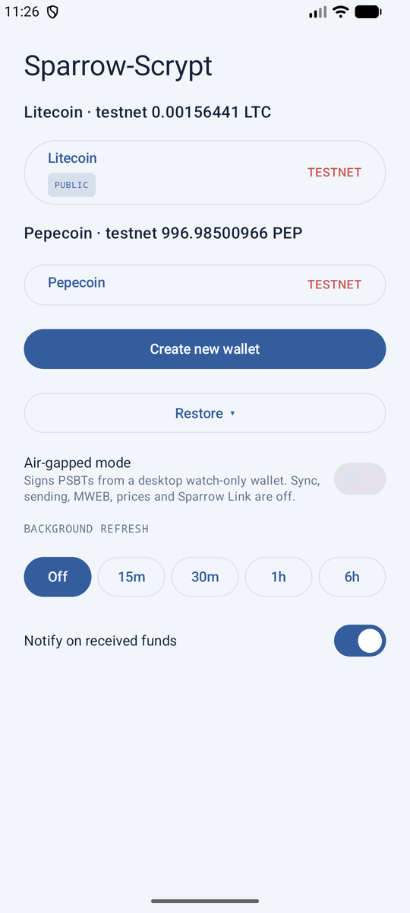
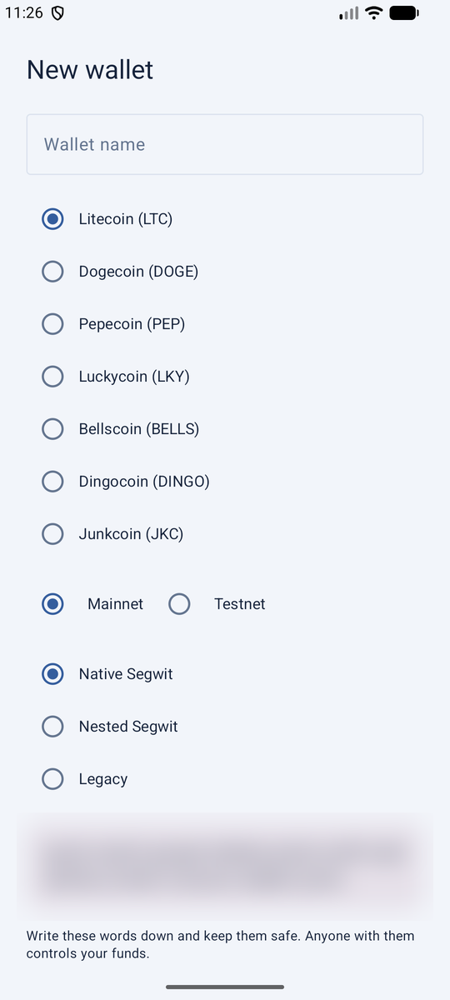
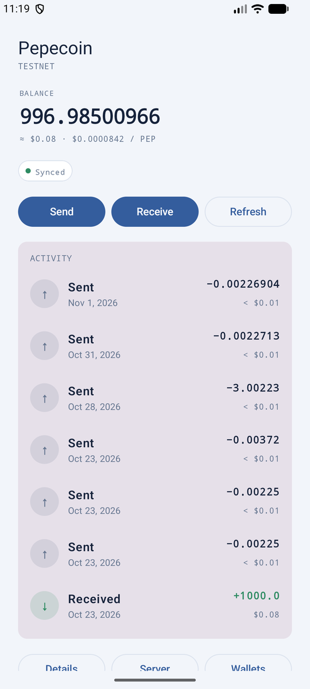
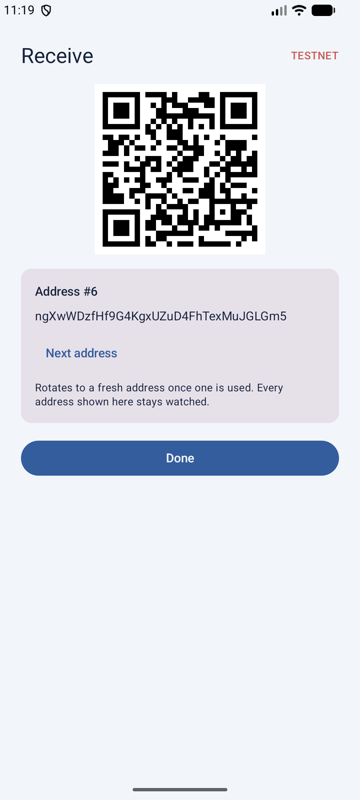
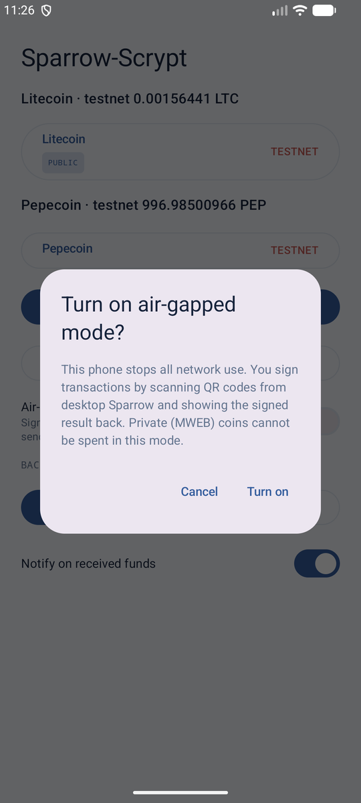

# Sparrow-Scrypt Mobile

Sparrow-Scrypt Mobile is the Android companion to [Sparrow-Scrypt](https://github.com/scryptofoundation/sparrow-scrypt), a wallet for seven Scrypt coins: Litecoin, Dogecoin, Pepecoin, Junkcoin, Luckycoin, Bellscoin and Dingocoin. It is a full wallet on its own, and it pairs with the desktop app by QR code to share wallets and labels, or to sign the desktop's transactions while offline.

Android only for now. There is no iPhone version yet.

## Status: beta

Current version: **0.17.0 beta 3** (tag `v0.17.0-beta.3`).

Sparrow-Scrypt Mobile is in public testing. Expect bugs. Use testnet wallets where you can and small amounts where you can't, and never put a seed that holds real savings into a beta build.

Every wallet picks Mainnet or Testnet when you create it, so you can keep test wallets and real ones side by side.

| Coin | Ticker | Mainnet | Testnet |
| --- | --- | --- | --- |
| Litecoin | LTC | Supported (public Electrum servers) | Public testnet |
| Pepecoin | PEP | Supported (public Esplora server) | Public testnet |
| Junkcoin | JKC | Supported (public Esplora server) | Public testnet |
| Dogecoin | DOGE | Supported (public Electrum servers) | Your own node, or mainnet with small amounts |
| Luckycoin | LKY | Supported (public Esplora server) | Your own node, or mainnet with small amounts |
| Bellscoin | BELLS | Supported (public Esplora server) | Your own node, or mainnet with small amounts |
| Dingocoin | DINGO | Supported (public Electrum servers) | Your own node, or mainnet with small amounts |

## What it does

- Seven Scrypt coins in one app. Each wallet belongs to one coin, and the home screen groups wallets by coin with a total for each.
- New and restored wallets, with the script types each coin supports.
- Seed imports from each coin's own wallet app (MyDoge, Peppool, Dingo, JunkieWally, luckycoinwallet, Nintondo) and from Cake Wallet.
- Litecoin MWEB: a private balance next to the public one.
- Pairing with Sparrow-Scrypt on the desktop by QR code (Tools > Link with Mobile): copy a wallet from the desktop, send a phone wallet to the desktop, and keep labels in step.
- Air-gapped mode: the phone holds the keys and signs PSBTs from a desktop watch-only wallet by QR code, with sync, sending and every network feature turned off. It works for every coin and script type.
- An inscription guard that holds back coins that may carry inscriptions or tokens, so they are not spent by accident.
- Servers set per coin: the public servers, or your own Electrum server or Esplora API, optionally over Tor through Orbot.

## Screenshots

All taken on testnet with throwaway wallets.

| | |
| --- | --- |
|  |  |
| A new wallet: pick the coin, the network and the script type | A Pepecoin testnet wallet and its history |
|  |  |
| Receive | Turning on air-gapped mode |

## Download

The APK is on the [Releases](../../releases) page, with a SHA256 checksum. Check the file before you install it.

| System | File |
| --- | --- |
| Android 8.0 or later | `Sparrow-Scrypt-Mobile-0.17.0-beta.3.apk` |

The app is not in the Play Store yet. To install it, open the APK on your phone and allow your browser or file manager to install unknown apps when Android asks.

Every release is signed with the same key. Its SHA-256 certificate fingerprint is:

`5E:A1:04:86:53:A3:A4:F8:20:69:F0:C7:8A:37:14:E2:F5:C6:BC:CB:B2:D6:B0:3C:35:23:9F:CE:47:A3:11:5D`

You can check it with `apksigner verify --print-certs Sparrow-Scrypt-Mobile-0.17.0-beta.3.apk`.

## Building

Building needs JDK 17 or later and the Android SDK (compile SDK 35). Point `ANDROID_HOME` at the SDK, then:

`./gradlew :app:assembleDebug`

The debug APK lands in `app/build/outputs/apk/debug`. A release build is signed only when a `keystore.properties` file names a key (`storeFile`, `storePassword`, `keyAlias`, `keyPassword`); that file and the key are never committed.

The project is Kotlin Multiplatform:

| Module | What it holds |
| --- | --- |
| `core-crypto` | Keys, addresses, scripts, PSBTs and signing for every coin, checked against vectors generated by the desktop app's library |
| `electrum` | Electrum and Esplora clients and the wallet scanner |
| `storage` | The encrypted wallet vault and the desktop link formats |
| `app` | The Android app |

The tests run on the JVM: `./gradlew :core-crypto:jvmTest :storage:jvmTest :electrum:jvmTest -PskipLive`

## Reporting problems

Open an issue in this repository with the coin, the network, your phone and Android version, and what happened. Never post a seed, a private key or a wallet backup. Security problems go to the private route on the Security tab instead.

## License

Sparrow-Scrypt Mobile is licensed under the Apache 2 software licence, like Sparrow Wallet, Sparrow-LTC and Sparrow-Scrypt.

## Credit

Sparrow Wallet is by Craig Raw. Sparrow-LTC, the Litecoin port the desktop app builds on, is by Hector Chu.
